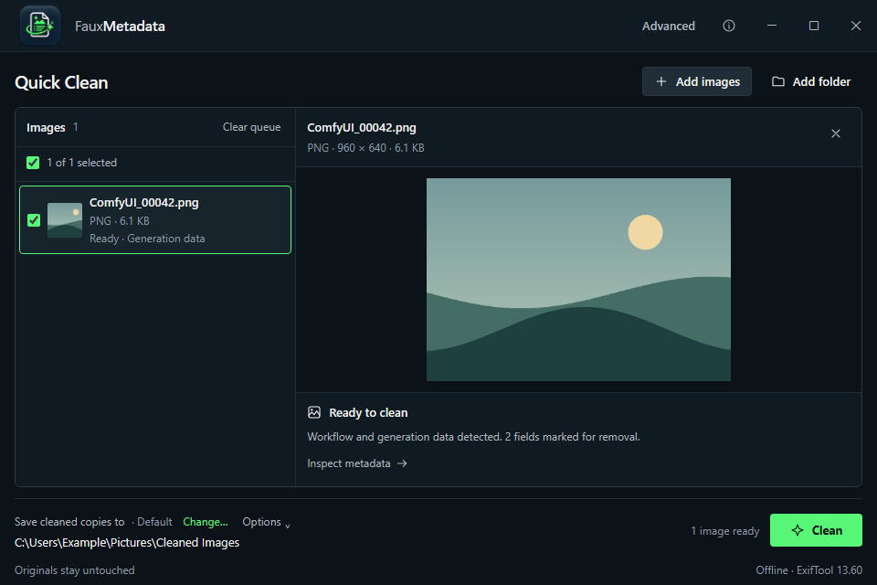
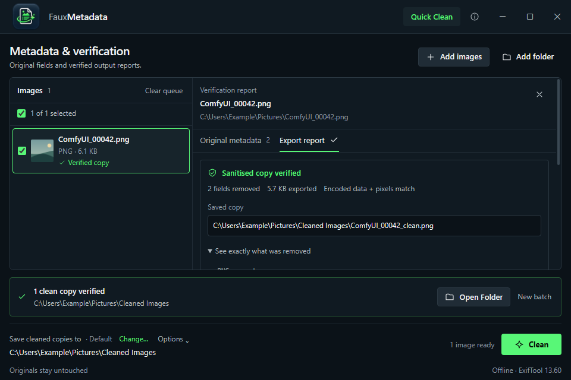

<p align="center">
  
</p>

# FauxMetadata

An offline Windows app that removes hidden metadata from images before you share them: ComfyUI workflows and prompts, A1111 generation parameters, model details, EXIF camera data, GPS location, XMP, IPTC and software tags.

Originals stay untouched. FauxMetadata writes a new copy, checks that the copy contains no unexpected metadata and that the picture is unchanged, and only then saves it. Images are never recompressed.



## Why

AI image tools embed the full generation workflow, prompt, seed and model names in every PNG they save. Cameras and phones add device details and often GPS coordinates. Most of this is invisible until someone opens the file in a metadata viewer. FauxMetadata shows you what is there, removes it and reports exactly what changed.

## Download

Get the latest installer or portable ZIP, plus `SHA256SUMS.txt`, from [Releases](https://github.com/fugnsig/FauxMetadata/releases).

### Requirements

- Windows 10 or 11, x64.
- [Microsoft Edge WebView2 Runtime](https://developer.microsoft.com/en-us/microsoft-edge/webview2/#download-section). It ships with current Windows 11 and most updated Windows 10 systems. The installer does not download it, so install it first on systems without it. The Evergreen Standalone Installer works offline.
- Nothing else. ExifTool and its Perl runtime are bundled.

Releases are not code-signed, so Windows SmartScreen may show a "Windows protected your PC" warning. Check the file's SHA-256 against `SHA256SUMS.txt` first:

```powershell
Get-FileHash -Path .\FauxMetadata-*-portable.zip -Algorithm SHA256
```

If it matches and you trust the source, choose More info → Run anyway. A matching checksum proves the file is the one published in the release; it is not a publisher signature. Follow your organisation's policy if execution is blocked.

## Using FauxMetadata

1. Run the installer, or extract the whole portable ZIP and launch `FauxMetadata.exe`. Keep the `resources` folder beside it.
2. Drop images or folders onto the window, or use Browse Images / Add Folder.
3. Select Clean. Copies are saved to Cleaned Images in your Pictures folder, created when first needed.
4. Use Open Folder or Copy Path to find the result.

Cleaned files are named `name_clean.png`, then `name_clean (1).png` and so on. Existing files are never replaced. Cancelling keeps copies that were already verified and discards unfinished ones.

Change… sets a different output folder, which is remembered. Options → Reset to Default returns to Pictures. Options → Auto-clean on drop (off by default) cleans images as soon as they are dropped. If a custom folder becomes unavailable, for example on a disconnected drive, exports stop until you reconnect it, choose another folder or reset. FauxMetadata never silently saves somewhere else.

Advanced shows every metadata field in the original and, after cleaning, a report of exactly what was removed and what was kept.



_Screenshots use synthetic example images._

| Shortcut     | Action                                     |
| ------------ | ------------------------------------------ |
| `Ctrl+O`     | Choose images                              |
| `Ctrl+Enter` | Clean the selected images                  |
| `Escape`     | Cancel processing or close an open section |

## What gets removed

| Information                                                       | Result                             |
| ----------------------------------------------------------------- | ---------------------------------- |
| ComfyUI workflows and prompts, A1111 parameters, generation notes | Removed                            |
| EXIF camera, author, software and date fields; GPS location       | Removed                            |
| XMP, IPTC and JPEG comments                                       | Removed                            |
| PNG text and time chunks; other non-rendering PNG chunks          | Removed                            |
| WebP EXIF, XMP and private chunks                                 | Removed                            |
| ICC colour profiles, including their description text             | Kept, so colours display correctly |
| JPEG orientation, colour space and resolution; PNG colour/density | Kept, so the image looks the same  |

FauxMetadata does not remove anything visible in the picture itself, hidden data encoded in pixels (steganography), or the file name and filesystem dates. It is a metadata cleaner, not an anonymity guarantee.

## Supported images

| Format | Supported                                                |
| ------ | -------------------------------------------------------- |
| PNG    | Still images, including palette, transparency and 16-bit |
| JPEG   | Standard 8-bit baseline and progressive, including CMYK  |
| WebP   | Still lossy and lossless, with or without transparency   |

These are rejected rather than risk changing how the image looks: animated PNG/WebP, HDR PNG, arithmetic-coded, multi-picture or HDR gain-map JPEG, PNG or WebP files with rotation metadata, files with conflicting orientation tags, and damaged or ambiguous files. Documents, audio and video are out of scope.

## How verification works

Each export:

1. Copies the original to a private temporary folder on the destination drive.
2. Strips metadata with the bundled, pinned ExifTool and FauxMetadata's own container rules.
3. Re-reads the result and rejects it if any unexpected metadata field or file region remains.
4. Confirms the encoded image data, colour information and decoded pixels are identical to the original.
5. Saves the verified copy without overwriting any existing file.

ExifTool finishing without an error is not treated as success; only a copy that passes every check is saved. If the original changes after you add it, re-add it before cleaning.

The app makes no network connections. It has no telemetry, accounts, cloud service or updater. Cloud-sync software watching your output folder (for example OneDrive) is outside its control.

### Limits

| Item              | Limit                                                                             |
| ----------------- | --------------------------------------------------------------------------------- |
| File size         | 128 MiB per image                                                                 |
| Dimensions        | 40 megapixels, and 32,768 pixels per side                                         |
| Embedded metadata | 8 MiB per PNG (after decompression) or WebP                                       |
| Queue             | 500 images                                                                        |
| Folder scanning   | 16 levels deep, 10,000 paths per import, 10,000 entries per folder; links skipped |

### Files it creates

| Item              | Location                                                                 |
| ----------------- | ------------------------------------------------------------------------ |
| Cleaned copies    | `Cleaned Images` in your Pictures folder (follows a redirected Pictures) |
| Preferences       | `%APPDATA%\app.fauxmetadata.desktop\preferences.json`                    |
| Temporary staging | `.fauxmetadata-*` folders inside the output folder, removed after export |

A crash or power loss during an export can leave a `.fauxmetadata-*` folder behind. It is safe to delete once FauxMetadata is not running.

To uninstall, use Settings → Apps for the installed version, or delete the portable folder. Delete the preferences folder above to remove saved settings.

## Project status

FauxMetadata is a personal project shared in case it is useful to others. It has an automated Rust and TypeScript test suite that runs the real bundled ExifTool, plus seeded fuzzing of the PNG, JPEG and WebP parsers ([reports](docs/fuzz-reports/)). Not yet done: testing on clean Windows 10 installs, multi-monitor DPI, and an independent security review.

## Building from source

Prerequisites: Node.js 24, stable MSVC Rust with `rustfmt` and `clippy`, Microsoft C++ Build Tools (Desktop development with C++ with a Windows SDK), and WebView2. See the [Tauri Windows prerequisites](https://v2.tauri.app/start/prerequisites/#windows). Layout tests also use the installed Microsoft Edge.

```powershell
git clone https://github.com/fugnsig/FauxMetadata.git
cd FauxMetadata
npm ci
npm run verify      # formatting, lint, build, frontend and Rust tests, layout checks
npm run tauri dev
```

The pinned ExifTool runtime is committed under `src-tauri/resources/exiftool/` and checked against a hash inventory during the build. Installing dependencies needs internet access; the built app does not. A manually triggered [GitHub Actions workflow](https://github.com/fugnsig/FauxMetadata/actions/workflows/windows-checks.yml) runs the same `npm run verify`.

To package:

```powershell
npm run tauri build
node scripts/package-portable.mjs
$version = (Get-Content package.json -Raw | ConvertFrom-Json).version
Compress-Archive -LiteralPath "artifacts/FauxMetadata-$version-portable" -DestinationPath "artifacts/FauxMetadata-$version-portable.zip"
```

This produces an unsigned x64 NSIS installer and a portable folder under `artifacts/`.

## Reporting issues

Bug reports are welcome in [Issues](https://github.com/fugnsig/FauxMetadata/issues). Please reproduce problems with synthetic test images. Never attach personal photos, real prompts, GPS data or credentials.

Report security vulnerabilities privately through [GitHub's vulnerability reporting](https://github.com/fugnsig/FauxMetadata/security/advisories/new), not in a public issue. This is a spare-time project, so there is no guaranteed response time.

## Acknowledgements

Metadata reading and writing uses [ExifTool](https://exiftool.org/) by Phil Harvey, bundled with a [Strawberry Perl](https://strawberryperl.com/) runtime. The app is built with [Tauri](https://tauri.app/).

## Licence

FauxMetadata is released under the [MIT Licence](LICENSE). Bundled third-party components keep their own licences: ExifTool is distributed under the same terms as Perl (Artistic Licence or GPL). See [THIRD_PARTY_NOTICES.txt](THIRD_PARTY_NOTICES.txt) and the licence files shipped in `src-tauri/resources/exiftool/`.
